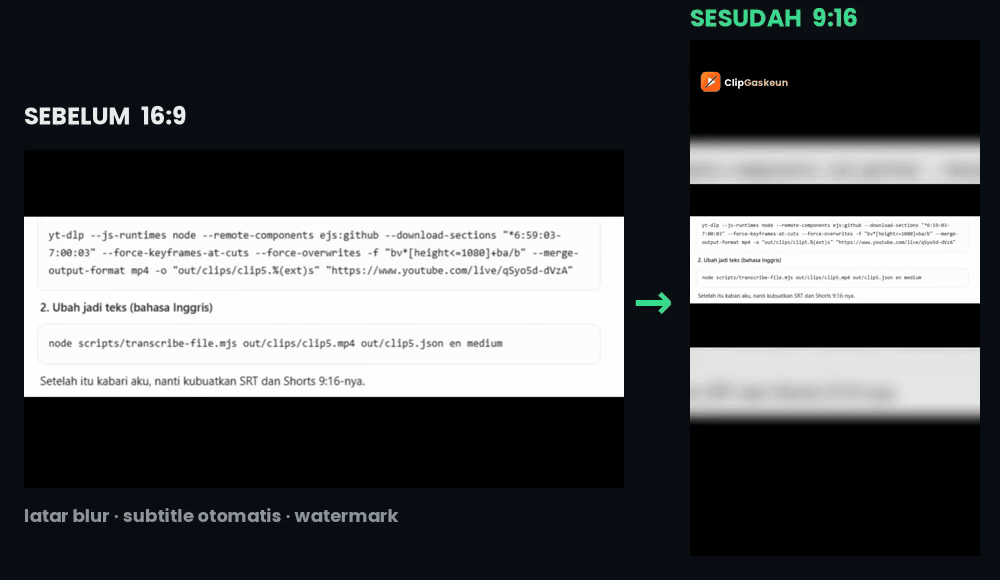

# ClipGaskeun

[Bahasa Indonesia](README.md) · **English**

Cut long videos (streams, podcasts, etc.) into 9:16 Shorts with a blurred background, automatic subtitles and an optional watermark. Works from a file on your computer **or straight from a YouTube link**. Runs locally, free, no paid API.



*The demo above: an Indonesian-language screen recording processed with a single command. The language was detected automatically.*

> The command-line options keep their Indonesian names and values (`--cek`, `--auto-cepat`, `--sub-pos bawah`, ...). This page explains each one.

## Requirements
- **ffmpeg** (every install method)
- **Deno** (YouTube links only): yt-dlp uses it to get past YouTube's player checks. Windows: `winget install DenoLand.Deno`, macOS: `brew install deno`.
- **Python 3.9+** ([python.org](https://www.python.org/downloads/), tick "Add Python to PATH" on Windows). *Not needed* for the Windows `.exe`.
- faster-whisper (subtitles), yt-dlp (YouTube links) and rich (terminal display) come included with both the `.exe` and the quick install.

## Easiest (Windows): the .exe, no Python needed
1. Install ffmpeg: open PowerShell and run `winget install ffmpeg` (for YouTube links also `winget install DenoLand.Deno`). Close and reopen the terminal.
2. Download **`clipgaskeun-windows.zip`** from [Releases](https://github.com/ululbiasaajaa/clipgaskeun/releases/latest) and extract it.
3. Open the extracted `clipgaskeun` folder, click File Explorer's address bar, type `cmd`, press Enter. A terminal opens in that folder.
4. Use the examples below with `clipgaskeun.exe` in front:
   ```
   clipgaskeun.exe D:\Videos\stream.mp4 --cut 1:05-1:40 --preset tiktok
   clipgaskeun.exe "https://www.youtube.com/watch?v=VIDEO_ID" --auto
   ```
Double-clicking `clipgaskeun.exe` shows a short guide and a dependency check. The program itself runs from the terminal.

If YouTube downloads suddenly fail, the yt-dlp inside the package is probably outdated. Install yt-dlp separately (`winget install yt-dlp`, update with `winget upgrade yt-dlp`). ClipGaskeun prefers the system yt-dlp automatically, so you don't have to wait for a new `.exe`.

## Install (any OS, with Python)

### 1. Install ffmpeg
- **Windows:** `winget install ffmpeg`, then reopen the terminal.
- **macOS:** `brew install ffmpeg`
- **Linux (Debian/Ubuntu):** `sudo apt install ffmpeg`

Check: `ffmpeg -version` should print a version number.

### 2a. Quick install (recommended): one command with pipx
```
pip install pipx
pipx ensurepath
```
Reopen the terminal, then:
```
pipx install git+https://github.com/ululbiasaajaa/clipgaskeun.git
```
No git? Use this instead:
```
pipx install https://github.com/ululbiasaajaa/clipgaskeun/archive/refs/heads/main.zip
```
The `clipgaskeun` command now works from any folder. Update later with `pipx upgrade clipgaskeun`.

### 2b. Or manually
```
git clone https://github.com/ululbiasaajaa/clipgaskeun.git
cd clipgaskeun
pip install -r requirements.txt
```
With this method, replace `clipgaskeun` in every example with `python clipgaskeun.py`.

### 3. Check your setup
```
clipgaskeun --cek
```
Shows what is installed and how to install what is missing.

## Usage

**Time format for `--cut`:** seconds (`90`), minutes:seconds (`1:30`) or hours:minutes:seconds (`4:09:41`). Fractions are fine (`1:30.5`). Separate start and end with a minus: `1:05-1:40`. Minutes and seconds after a colon must be 00–59, and each part must be at least 0.5 s.

> **The spoken language is detected automatically.** If it is detected wrongly, ClipGaskeun tells you in the terminal; run again with `--lang en`, `--lang id`, etc.

### From a file
One part:
```
clipgaskeun video.mp4 --cut 4:09:41-4:10:17
```
Join several parts, use the TikTok preset and a logo, choose the output name:
```
clipgaskeun video.mp4 --cut 1:05-1:40 --cut 5:10-5:30 --preset tiktok --logo clipgaskeun-watermark.png -o result.mp4
```
The result is saved **next to the original video** as `<name>_short.mp4`.

### From a YouTube link
```
clipgaskeun "https://www.youtube.com/watch?v=VIDEO_ID" --cut 4:09:41-4:10:17
```
- **The times in `--cut` are the times in the YouTube video**, no maths needed.
- Only the requested part is downloaded (plus 3 s of padding on each side), not the whole video.
- **Always quote the link** (`"..."`), especially in PowerShell: `&` and `?` can break the command.
- The result is saved **in the folder you run the command from** as `clipgaskeun_short.mp4`.
- Join several parts of one link by repeating `--cut`.

### Find good moments automatically (`--auto`)
Don't know which minute is worth clipping? Let ClipGaskeun look:
```
clipgaskeun "https://www.youtube.com/watch?v=VIDEO_ID" --auto
clipgaskeun stream.mp4 --auto --preset tiktok
```
You get a table of 5 candidates with time range, score, reason and the first words spoken. Type a number (`1`, or `1,3` for several). Each number becomes its own Short (`<name>_auto1.mp4`, `_auto3.mp4`, ...).

How it searches, all local and free:
- **YouTube links:** uses YouTube's **Most Replayed** data (the parts viewers replay most), read without downloading the video. For each candidate only the *audio* is downloaded to find the best cut.
- **Local files, or videos without Most Replayed data:** finds where the audio peaks (laughing, shouting, hype) compared with the rest of the video.
- Each candidate is then re-scored by **how dense the talking is** (from a quick transcript), and its start and end are moved to **sentence breaks** so nobody gets cut off mid-sentence.

These are estimates, not guarantees: a high score means "worth checking first". Watch the clip before you upload it.

| Option | What it does |
|---|---|
| `--auto-len 45` | Length of each moment, 15–90 s (default 45). |
| `--auto-n 5` | Number of candidates, 1–10 (default 5). |
| `--pick 1,3` | Render those numbers straight away, without asking. |
| `--auto-cepat` | ("fast") Skip the transcript scoring: much quicker, but no preview text. |
| `--auto-model` | Whisper model used to score candidates (default `base`, fast). Final subtitles still use `--model`. |
| `--json` | JSON output (candidates and output files) for scripts or coding agents such as Claude Code. |

### Where is the result, and will it be overwritten?
- Different name or folder: use `-o`, e.g. `-o D:\Shorts\clip1.mp4`. Missing folders are created.
- If the automatic name is taken, a number is added (`_short_2.mp4`, `_short_3.mp4`, ...), so **earlier clips are never overwritten**. With `-o` and an existing name, that file is overwritten.
- Videos without sound still work (silent result, no automatic subtitles).

**First run:** the Whisper model (about 500 MB) is downloaded automatically, so the first subtitle step takes longer.

## Presets
Ready-made styles:

| Preset | Subtitles |
|---|---|
| `--preset tiktok` | Karaoke: the word being spoken lights up **yellow**, 4 words per line, slightly bigger. |
| `--preset podcast` | Plain lines on a **dark box**, readable on any background. |
| `--preset gaming` | **Green** karaoke placed **above the video** so the game stays visible. |

Without `--preset`: white subtitles with a black outline below the video. Options you write yourself always win over the preset, e.g. `--preset tiktok --highlight hijau`.

## Options
| Option | What it does |
|---|---|
| `--cut START-END` | Time range (`1:05-1:40`). Repeat to join parts in order. |
| `--auto` | Find good moments automatically (instead of `--cut`, see above). |
| `-o, --out` | Output file name and location. |
| `--preset` | `tiktok`, `podcast` or `gaming` (see above). |
| `--lang` | Spoken language, e.g. `en` or `id`. Default: auto-detected. |
| `--model` | Whisper model. Default `small` (all languages). `medium` is more accurate but slower; `small.en` is a bit faster for English. |
| `--no-subs` | No subtitles. |
| `--srt file.srt` | Use your own subtitles (times relative to the start of the result). |
| `--style` | `biasa` (plain) or `karaoke` (the spoken word lights up). |
| `--sub-pos` | Subtitle position: `bawah` (bottom, default), `tengah` (middle), `atas` (top). |
| `--sub-color` | Text colour: `putih` (white, default), `kuning` (yellow), `hijau` (green), `merah` (red), `biru` (blue), `oranye`, `pink`, `hitam` (black), or a hex code such as `FFD400`. |
| `--highlight` | Colour of the lit-up word in karaoke style (default `kuning`, yellow). |
| `--sub-bg` | `kotak` for a dark box behind the subtitles, `tidak` (none, default) for an outline. |
| `--font`, `--font-size` | Subtitle font and size (default Poppins, 10; size `4`–`40`). If the font isn't installed, ffmpeg falls back to a default font. |
| `--logo file.png` | PNG watermark in the top-left corner. |
| `--logo-scale` | Logo size, `0.05`–`3` (default `0.62`). |
| `--cek` | ("check") Check ffmpeg, faster-whisper, yt-dlp, etc. |
| `--version` | Show the version. |

## Troubleshooting
Run `clipgaskeun --cek` first; it usually shows what's missing.
- **`ffmpeg tidak ditemukan`** (ffmpeg not found): install ffmpeg (step 1) and open a new terminal.
- **`faster-whisper belum terpasang`** / **`yt-dlp belum terpasang`** (not installed): use the quick install (2a) or `pip install -r requirements.txt`.
- **Windows blocks `clipgaskeun.exe` ("Windows protected your PC")**: the file isn't signed with a paid certificate. Click **More info → Run anyway**, or right-click the zip → Properties → tick **Unblock** before extracting.
- **`clipgaskeun` not recognised** after pipx: run `pipx ensurepath`, then reopen the terminal.
- **`yt-dlp gagal mengunduh`** (download failed): YouTube changes often. Update yt-dlp with `pip install -U "yt-dlp[default]"` (pipx: `pipx upgrade clipgaskeun`) and try again.
- **Warning `n challenge solving failed` / `Error solving ... using "deno"`**: yt-dlp's solver doesn't know YouTube's newest player yet. Update yt-dlp as above. To always use the newest solver, create a yt-dlp config file containing `--remote-components ejs:github`:
  - Windows (cmd): `mkdir "%APPDATA%\yt-dlp"` then `echo --remote-components ejs:github> "%APPDATA%\yt-dlp\config.txt"`
  - macOS/Linux: `mkdir -p ~/.config/yt-dlp && echo "--remote-components ejs:github" > ~/.config/yt-dlp/config`
- **Two yt-dlp installs** (`where yt-dlp` on Windows, `which -a yt-dlp` on macOS/Linux): ClipGaskeun uses the first one, so update that one.
- **`0 kata`** (0 words): no speech in that part, so the video is rendered without subtitles.
- **`Format waktu salah`** (wrong time format): check `--cut`, e.g. `1:05-1:40` (not `1::05` or `1:75`).
- **`melewati akhir video`** (past the end of the video): the end time is longer than the video.
- **Wrong language / subtitles came out translated**: add `--lang` with the right language.
- **`--auto` is slow on long videos**: for local files the whole audio is analysed first (a 4-hour stream takes a few minutes). Use `--auto-cepat`, or a YouTube link that has Most Replayed data.
- **Subtitles have wrong words**: try a bigger model, e.g. `--model medium`.

## Contributing
Quick tests (no ffmpeg or Whisper model needed):
```
pip install pytest
python -m pytest
```
GitHub Actions runs the same tests on every push. The Windows `.exe` is built by GitHub Actions (`.github/workflows/release.yml`) whenever a version tag is pushed (e.g. `git tag v0.4.0`, `git push --tags`) and appears on the Releases page.

## Important
Downloading and reusing other people's content may violate YouTube's Terms of Service and the creator's copyright. Only use it on content you own or have clear permission to use. You are responsible for how you use it.

## License
MIT, see `LICENSE`.
