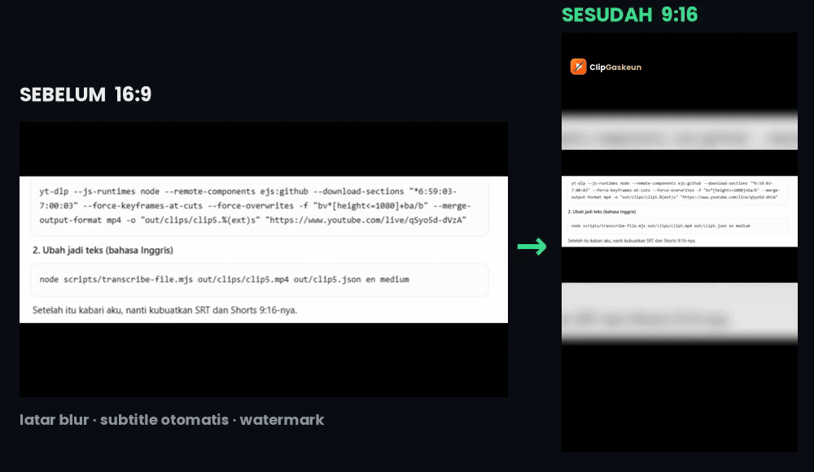

# ClipGaskeun

Potong video panjang (stream, podcast, dll) jadi Shorts 9:16 dengan latar blur, subtitle otomatis, dan watermark opsional. Bisa dari file di komputermu **atau langsung dari link YouTube**. Jalan lokal, gratis, tanpa API berbayar.



*Contoh di atas: rekaman layar berbahasa Indonesia, diproses dengan satu perintah. Bahasa dideteksi otomatis.*

## Yang dibutuhkan
- **Python 3.9+** ([python.org](https://www.python.org/downloads/), centang "Add Python to PATH" saat instal di Windows)
- **ffmpeg**
- faster-whisper (subtitle), yt-dlp (link YouTube), dan rich (tampilan terminal). Ketiganya ikut terpasang otomatis kalau kamu memakai cara pasang cepat di bawah.

## Pasang

### 1. Pasang ffmpeg
- **Windows:** buka PowerShell, jalankan `winget install ffmpeg`. Tutup lalu buka lagi terminalnya.
- **macOS:** `brew install ffmpeg`
- **Linux (Debian/Ubuntu):** `sudo apt install ffmpeg`

Cek berhasil: `ffmpeg -version` harus menampilkan nomor versi.

### 2a. Pasang cepat (disarankan): satu perintah lewat pipx
```
pip install pipx
pipx ensurepath
```
Tutup lalu buka lagi terminal, kemudian:
```
pipx install git+https://github.com/ululbiasaajaa/clipgaskeun.git
```
Belum punya git? Pakai ini sebagai gantinya:
```
pipx install https://github.com/ululbiasaajaa/clipgaskeun/archive/refs/heads/main.zip
```
Setelah itu perintah `clipgaskeun` bisa dipakai dari folder mana saja. Memperbarui ke versi terbaru: `pipx upgrade clipgaskeun`.

### 2b. Atau cara manual (unduh foldernya)
```
git clone https://github.com/ululbiasaajaa/clipgaskeun.git
cd clipgaskeun
pip install -r requirements.txt
```
Dengan cara ini, ganti `clipgaskeun` di semua contoh dengan `python clipgaskeun.py`.

### 3. Cek kelengkapan
```
clipgaskeun --cek
```
Muncul tabel berisi apa yang sudah terpasang dan cara memasang yang belum.

## Pakai

**Format waktu di `--cut`:** detik (`90`), menit:detik (`1:30`), atau jam:menit:detik (`4:09:41`). Pecahan detik boleh (`1:30.5`). Pisahkan awal dan akhir dengan tanda minus: `1:05-1:40`. Menit dan detik setelah titik dua harus 00–59, dan tiap bagian minimal 0,5 detik.

> **Bahasa video dideteksi otomatis** (Indonesia, Inggris, dan lainnya). Kalau terdeteksi salah, ClipGaskeun memberi tahu di terminal; ulangi dengan `--lang id` (Indonesia) atau `--lang en` (Inggris).

### Dari file di komputer
Potong satu bagian:
```
clipgaskeun video.mp4 --cut 4:09:41-4:10:17
```
Gabung beberapa bagian, pakai preset TikTok dan logo, tentukan nama hasil:
```
clipgaskeun video.mp4 --cut 1:05-1:40 --cut 5:10-5:30 --preset tiktok --logo clipgaskeun-watermark.png -o hasil.mp4
```
Hasilnya disimpan **di folder yang sama dengan video asli**, bernama `<nama>_short.mp4`.

### Dari link YouTube
```
clipgaskeun "https://www.youtube.com/watch?v=ID_VIDEO" --cut 4:09:41-4:10:17
```
- **Waktu di `--cut` adalah waktu di video YouTube-nya**, jadi tidak perlu menghitung apa-apa.
- Yang diunduh hanya bagian yang kamu minta (ditambah 3 detik cadangan di awal dan akhir), bukan seluruh video.
- **Selalu beri tanda kutip pada link** (`"..."`), terutama di PowerShell, karena karakter `&` dan `?` di link bisa memecah perintah.
- Hasilnya disimpan **di folder tempatmu menjalankan perintah**, bernama `clipgaskeun_short.mp4`.
- Boleh menggabung beberapa bagian dari satu link dengan `--cut` berulang.

### Di mana hasilnya, dan apakah tertimpa?
- Mau lokasi atau nama lain: pakai `-o`, misalnya `-o D:\Shorts\klip1.mp4`. Folder yang belum ada dibuat otomatis.
- Kalau nama otomatis sudah dipakai, hasil baru diberi nomor (`_short_2.mp4`, `_short_3.mp4`, ...), jadi **klip sebelumnya tidak tertimpa**. Kalau kamu memakai `-o` dengan nama yang sudah ada, file itu akan ditimpa.
- Video tanpa suara tetap bisa diproses (hasilnya hening, tanpa subtitle otomatis).

**Catatan pertama kali:** model Whisper diunduh otomatis (sekitar 500 MB), jadi langkah subtitle pertama akan lebih lama. Sesudahnya tidak perlu unduh lagi.

## Preset
Gaya siap pakai, supaya tidak perlu mengatur satu per satu:

| Preset | Subtitle |
|---|---|
| `--preset tiktok` | Karaoke: kata yang sedang diucapkan menyala **kuning**, 4 kata per baris, sedikit lebih besar. |
| `--preset podcast` | Kalimat biasa dengan **kotak gelap** di belakangnya, mudah dibaca di latar apa pun. |
| `--preset gaming` | Karaoke **hijau**, diletakkan **di atas video** supaya tidak menutupi layar game. |

Tanpa `--preset`: subtitle putih bergaris tepi hitam di bawah video. Opsi yang kamu tulis sendiri selalu menang atas preset, misalnya `--preset tiktok --highlight hijau`.

## Opsi
| Opsi | Fungsi |
|---|---|
| `--cut MULAI-SELESAI` | Rentang waktu (`1:05-1:40`). Boleh diulang, bagian-bagiannya digabung berurutan. |
| `-o, --out` | Nama dan lokasi file hasil. |
| `--preset` | `tiktok`, `podcast`, atau `gaming` (lihat di atas). |
| `--lang` | Bahasa ucapan, mis. `id` atau `en`. Default: dideteksi otomatis. |
| `--model` | Model Whisper. Default `small` (semua bahasa). `medium` lebih akurat tapi lebih lambat; `small.en` sedikit lebih cepat untuk video berbahasa Inggris. |
| `--no-subs` | Tanpa subtitle. |
| `--srt file.srt` | Pakai subtitle buatan sendiri (waktunya relatif ke awal hasil). |
| `--style` | `biasa` atau `karaoke` (kata yang sedang diucapkan menyala). |
| `--sub-pos` | Posisi subtitle: `bawah` (default), `tengah`, `atas`. |
| `--sub-color` | Warna teks: `putih` (default), `kuning`, `hijau`, `merah`, `biru`, `oranye`, `pink`, `hitam`, atau kode hex seperti `FFD400`. |
| `--highlight` | Warna kata yang menyala di gaya karaoke (default `kuning`). |
| `--sub-bg` | `kotak` untuk kotak gelap di belakang subtitle, `tidak` (default) untuk garis tepi. |
| `--font`, `--font-size` | Font dan ukuran subtitle (default Poppins, 10; ukuran `4`–`40`). Kalau font tidak terpasang, ffmpeg memakai font bawaan. |
| `--logo file.png` | Watermark PNG di pojok kiri atas. |
| `--logo-scale` | Ukuran logo, `0.05`–`3` (default `0.62`). |
| `--cek` | Periksa ffmpeg, faster-whisper, yt-dlp, dll. |
| `--version` | Tampilkan versi. |

Contoh video berbahasa Indonesia, bahasanya dikunci supaya tidak salah deteksi:
```
clipgaskeun "https://www.youtube.com/watch?v=ID_VIDEO" --cut 12:00-12:45 --lang id --preset tiktok
```

## Kalau ada masalah
Jalankan `clipgaskeun --cek` dulu: biasanya langsung kelihatan apa yang kurang.
- **`ffmpeg tidak ditemukan`**: ffmpeg belum terpasang atau belum ada di PATH. Ulangi langkah 1 dan buka terminal baru.
- **`faster-whisper belum terpasang`** / **`yt-dlp belum terpasang`**: pakai cara pasang cepat (langkah 2a), atau `pip install -r requirements.txt`.
- **`clipgaskeun` tidak dikenali** setelah pipx: jalankan `pipx ensurepath`, lalu tutup dan buka lagi terminal.
- **`yt-dlp gagal mengunduh`**: YouTube sering mengubah sistemnya, jadi perbarui yt-dlp dengan `pip install -U yt-dlp` (kalau lewat pipx: `pipx upgrade clipgaskeun`), lalu coba lagi.
- **`0 kata`**: tidak ada ucapan di bagian itu, jadi video dirender tanpa subtitle.
- **`Format waktu salah`**: cek penulisan `--cut`, misalnya `1:05-1:40` (bukan `1::05` atau `1:75`).
- **`melewati akhir video`**: waktu selesai lebih panjang dari videonya. Cek panjang video lalu ganti angkanya.
- **Bahasa terdeteksi salah / subtitle jadi terjemahan**: tambahkan `--lang id` (atau bahasa yang benar).
- **Subtitle salah-salah kata**: coba model lebih besar, misalnya `--model medium`.

## Untuk yang mau ikut mengembangkan
Tes cepat (tidak butuh ffmpeg atau model Whisper):
```
pip install pytest
python -m pytest
```
Tes yang sama dijalankan otomatis oleh GitHub Actions setiap kali ada push.

## Penting
Mengunduh dan memakai ulang konten orang lain bisa melanggar Ketentuan Layanan YouTube dan hak cipta kreatornya. Gunakan hanya untuk konten yang kamu punya haknya atau yang izin pemakaiannya jelas. Tanggung jawab pemakaian ada pada kamu.

## Lisensi
MIT, lihat file `LICENSE`.
